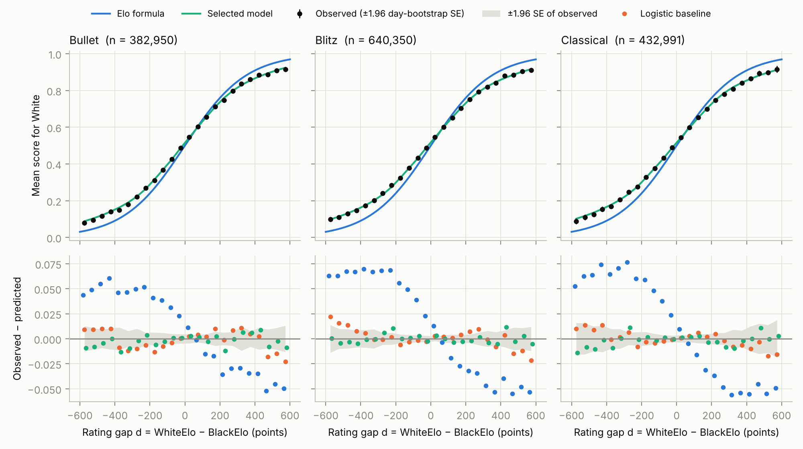

# Is the Elo Formula Overconfident on Lichess?

ESE 4020 (Statistics for Data Science, Penn, Fall 2026) final project. Liam Campbell, Xinran Gao, Pedro Sánchez-Gil Galindo.

**Question.** Do Lichess rating gaps predict game outcomes as well as the Elo expected-score formula claims, and how large is White's advantage across rating levels and time controls?

With S = White's score (1, 1/2 or 0) and d = WhiteElo − BlackElo, Elo predicts

```
E[S | d] = 1 / (1 + exp(−(β0 + β1·d))),   β0 = 0,   β1 = ln(10)/400 ≈ 0.00576.
```

We fit on January 2015 (1,478,833 games), select models by cross-validation on January only, and score every model once on February 2015 (1,476,869 games).

**Paper:** [`paper/main.pdf`](paper/main.pdf) (NeurIPS format, 6 pages + appendix). Every number in it is generated by `src/make_numbers.py` into `paper/numbers.tex`; none is typed by hand.



*February 2015 (held out), 50-point bins of rating gap. Elo's curve is too steep: it overstates the stronger side by up to 0.08. A logistic model refitted on January tracks the data within its error bars.*

## Findings

1. **Elo is overconfident on displayed ratings.** The fitted slope is 0.78 × Elo's (95% CI [0.778, 0.786]); 0.80 bullet, 0.77 blitz, 0.77 classical.
2. **Refitting two parameters captures almost all of the gain.** February log-loss: Elo 0.6265, logistic baseline 0.6220 (−45 × 10⁻⁴), spline 0.6218 (another −1.7), gradient boosting 0.6217 (another −3.2). Calibration error falls from 0.030 (Elo) to 0.004.
3. **White's advantage is about 1.7 percentage points of expected score** (≈ 15 rating points), nearly flat across rating bands and time controls. The slope rises with rating (0.75 → 0.84 × Elo above 1900).
4. **Rating noise could explain the shallow slope.** In a simulation with known truth, per-player rating noise of ≈ 50–56 points reproduces it. A smoothed-rating test (each player's mean rating on earlier days) shows displayed ratings are noisy: with both gaps in the model the combined slope rises to 0.87 × Elo. Noise also inflates White's advantage in rating points but not in score units, which is why we report the latter.

All intervals: 95% percentile, day-level bootstrap (resampling whole days, since players recur within a day), seed 4020.

## Method and course sections

- **Maximum likelihood (3C).** Logistic regression minimizing the mean negative log-likelihood; draws enter as S = 1/2 (a win and a loss with weight 1/2 each). Newton's method on games grouped by (day, time control, d).
- **K-fold CV (4A).** 5 folds, each a contiguous block of January days. The CV loss is the fold-size-weighted mean. Spline knots, standardization and the floor are learned inside each training fold. Grid: 26 logistic configurations (pooled → by time control → + mean rating → + natural spline in d, with ridge) and 20 gradient-boosting configurations; edges of the grid were extended until the choice was interior or the curve was flat.
- **Test set once.** `select_models.py` writes `results/selection.json`; `final_test.py` refuses to run without it and logs every run to `results/test_set_log.txt` (one run).
- **Bootstrap.** Day-level, B = 2000 for headline numbers.
- **Gradient boosting** (later course material) is the comparison, never the only result.

## Leakage checklist (topic guide, Module 4)

- No tuning on the test set; February is read only by `final_test.py`, after selection is frozen.
- Every learned transform sits inside the folds.
- Folds are contiguous blocks of days; the test month follows the training month.
- One seed for all resampling; no best-of-many-seeds.
- Every filter is counted in `data/processed/filters_*.json`.
- Headline numbers were recomputed independently (scikit-learn on game-level rows) and match.

## Data

[Lichess open database](https://database.lichess.org/), standard rated games, January and February 2015, CC0 1.0. Filters, in order (Jan / Feb): correspondence −5,458 / −6,498; abandoned −11,708 / −10,187; missing rating −0 / −1; dated in the previous month −1,238 / −1,998.

**Privacy.** Usernames are mapped to integers in memory to count each player's games and compute earlier-day mean ratings, then dropped. No username is written to disk.

## Reproduce

```bash
pip install -r requirements.txt
./run_all.sh          # downloads ~570 MB, ~30 min on 2 cores, rebuilds the paper
```

The processed game tables are committed, so you can skip the download and run any step in `src/` directly (see `run_all.sh` for the order).

## Layout

```
src/parse_pgn.py        stream .pgn.zst, keep headers, count filters, earlier-day mean ratings
src/model.py            Elo, cells, Newton's method for (ridge) logistic regression, losses
src/features.py         feature ladder and natural cubic spline basis, fitted inside folds
src/baseline.py         checkpoint baseline: two-parameter fits, CV, day bootstrap
src/extended_cv.py      January CV for the logistic ladder and gradient boosting
src/select_models.py    freeze the model choice (results/selection.json)
src/rating_bands.py     slope and White's edge by rating band and time control
src/sensitivity.py      robustness subsets
src/noise_prev.py       smoothed-rating noise test
src/simulate_noise.py   simulation with known truth
src/final_test.py       February, scored once, with day-bootstrap intervals; key figure
src/make_numbers.py     every number in the paper -> paper/numbers.tex; appendix tables
paper/                  LaTeX source (official NeurIPS 2026 style), references, PDF
results/  figures/      outputs of the scripts above
submission/             files submitted at each checkpoint
AI_USE.md               log of AI-tool use
```

## Milestones

| Date | Milestone | Status |
|---|---|---|
| 2 Nov | Proposal | submitted |
| 9 Nov | Baseline checkpoint | submitted (`submission/baseline.txt`) |
| 16 Nov | Early paper draft | `submission/paper_draft.pdf` ready |
| 30 Nov | Analysis complete | done; teammate rerun pending |
| 4 Dec | Paper and video draft | paper drafted; video to do |
| 11 Dec | Final paper and video | |
