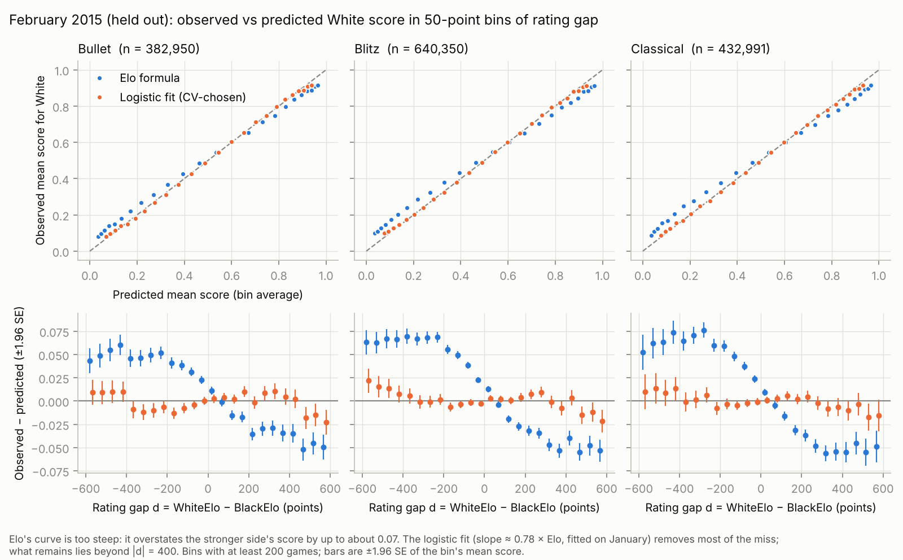

# Lichess Rating Calibration against the Elo Formula

ESE 4020 (Statistics for Data Science, Penn, Fall 2026) final project. Group: Xinran, Pedro, Liam.

**Question.** Do Lichess rating gaps predict game outcomes as well as the Elo expected-score formula claims, and how large is White's advantage across time controls?

With S = White's score (1, 1/2 or 0) and d = WhiteElo − BlackElo, Elo predicts

```
E[S | d] = 1 / (1 + exp(−(β0 + β1·d))),   β0 = 0,   β1 = ln(10)/400 ≈ 0.00576.
```

We fit β0 and β1 by maximum likelihood on January 2015 and test on February 2015. If β1 comes out below 0.00576, the formula is overconfident. β0/β1 is White's advantage in rating points.



*Figure: February 2015 games (held out) in 50-point bins of rating gap, by time control. Top: observed mean score against predicted. Bottom: observed minus predicted, ±1.96 SE. Elo's curve is too steep and overstates the stronger side's score by up to about 0.07. The logistic fit removes most of the miss; what remains lies beyond |d| = 400, which is what the planned spline in d is for.*

## Baseline results (checkpoint, 9 November)

**The Elo slope is too steep.** On January, β1 = 0.00450 [0.00448, 0.00452], 0.78 times Elo's 0.00576. By time control: 0.80× (bullet), 0.78× (blitz), 0.77× (classical).

**White's advantage is about 15 rating points.** β0/β1 = 14.8 [14.1, 15.7] overall; 13.4 [11.8, 14.9] bullet, 15.8 [14.8, 16.8] blitz, 14.9 [13.5, 16.3] classical. With 1.5 million games the differences between time controls clear their intervals, but they span only 2.5 rating points: practically small.

**The fit beats Elo on held-out games.** February log-loss: Elo 0.6265 [0.6256, 0.6274]; mean-score floor 0.6924 [0.6924, 0.6925]; CV-chosen logistic fit 0.6220 [0.6213, 0.6227]. Fit minus Elo: −0.0045 [−0.0047, −0.0043]. Brier score: Elo 0.2089, fit 0.2076.

**Noisy ratings explain only part of the low slope.** Noise in d biases a fitted slope toward zero, so we refit on games where both players are seen often in January. β1 rises from 0.78× Elo (all games) to 0.80×, 0.81×, 0.82× and 0.82× when both players have at least 10, 30, 100 and 300 games (96%, 89%, 67% and 28% of games), then stops rising. Most of the gap remains.

All intervals are 95% percentile intervals from a day-level bootstrap (B = 2000, seed 4020). Full numbers: [`results/summary.md`](results/summary.md) and [`results/results.json`](results/results.json).

## Method, and where it comes from in the course

**Logistic regression by maximum likelihood (Section 3C).** We minimize the mean negative log-likelihood

```
NLL(θ) = −(1/N) Σ [ S_i log σ(θᵀx_i) + (1 − S_i) log(1 − σ(θᵀx_i)) ],   x_i = (1, d_i).
```

A draw has S = 1/2, which is the same as entering it as a win and a loss with weight 1/2 each. Games that share (day, time control, d) share a prediction, so we sum them into cells, which leaves the likelihood unchanged. We use Newton's method: the gradient is the course's Σ (S_i − σ(θᵀx_i)) x_i, plus the Hessian Σ σ(1 − σ) x_i x_iᵀ. Newton converges in a handful of steps, which makes 2,000 bootstrap refits cheap.

**Model selection by K-fold cross-validation (Section 4A).** January is D_KF and February is D_Te. We use K = 5 folds, each a contiguous block of days (1–7, 8–13, 14–19, 20–25, 26–31). The grid is 2 structures × 7 ridge penalties:

- Structures: pooled (β0, β1), or separate β0 and β1 for bullet, blitz and classical.
- Penalty λ ∈ {0, 10⁻⁶, …, 10⁻¹}, a per-game penalty on the standardized slopes; intercepts are not penalized.

As in 4A, the CV loss is the fold-size-weighted average of the fold losses. We choose the lowest, retrain it on all of January, and score it once on February. CV chose separate β0 and β1 per time control with λ = 0. Its margin over pooled is 0.00001 ± 0.00001 log-loss (paired over folds), smaller than its error bar, so we call it a tie. Ridge never helped at this N.

**Error bars (bootstrap).** Players recur within a day, so games on the same day are not independent. We resample whole days with replacement and refit, B = 2000. That gives percentile intervals for β1, β0/β1 and each February score.

**Leakage checklist (the Module 4 failure modes from the topic guide).**

- *Tuning on the test set:* no. February plays no part in any choice and is read once, at the end of `baseline.py`, to score three baselines fixed in advance: Elo, the floor and the CV-chosen fit.
- *Preprocessing on all the data:* no. d is standardized inside each fit using only the training cells. The floor is the training fold's mean score.
- *Shuffling a time series into random folds:* no. Folds are contiguous blocks of days, and the test month comes after the training month.
- *Best of many seeds:* no. There is one seed (4020) for all resampling. A rerun from scratch on a second machine reproduced every number, intervals included.
- *Silently dropped rows:* no. Every filter's count is recorded (below and in `data/processed/filters_*.json`).

## Data

[Lichess open database](https://database.lichess.org/), standard rated games, January and February 2015. It is released under CC0 1.0, so redistributing the data and derived figures is allowed. We read only the PGN headers WhiteElo, BlackElo, Result, Event, TimeControl, Termination and UTCDate.

Filters, applied in order (January / February):

- Games in file: 1,497,237 / 1,495,553
- Correspondence (no clock): −5,458 / −6,498
- Abandoned: −11,708 / −10,187
- Missing rating: −0 / −1
- Unfinished result: −0 / −0
- Dated outside the month (started before midnight on the last day of the previous month): −1,238 / −1,998
- **Kept: 1,478,833 / 1,476,869**

Kept games by time control, January: bullet 405,362; blitz 639,890; classical 433,581. White's mean score is 0.519 and 3.7% of games are draws.

**Privacy.** Usernames are mapped to integers in memory only to count each player's games for the rating-noise check, then dropped. No username is written to disk. The processed files hold, per game: day, time control, both ratings, score, termination, and the two players' monthly game counts.

## Reproduce

Needs Python 3.10+ with numpy, pandas, matplotlib and zstandard (`pip install -r requirements.txt`).

```bash
./run_all.sh
```

That downloads the two monthly files (about 285 MB each) into `data/raw/`, parses them (under a minute per month), and runs `src/baseline.py` (about 75 seconds). Outputs go to `data/processed/`, `results/` and `figures/`. The processed files are committed, so `python3 src/baseline.py` alone reproduces every number without downloading anything.

To check the pipeline on data with a known answer:

```bash
python3 tests/make_synthetic_pgn.py 2015-01 60000 > /tmp/2015-01.pgn
```

The synthetic data plants β0 = 0.10 and β1 = 0.8 × Elo, with rating noise; parse it and run the baseline to see both recovered.

## Layout

```
src/parse_pgn.py      stream a .pgn.zst, keep header fields, apply and count filters
src/model.py          Elo, cell aggregation, Newton's method for (ridge) logistic regression, losses
src/baseline.py       5-fold CV on January, day bootstrap, rating-noise check, February scoring, figure
data/processed/       games_<month>.csv.gz and filters_<month>.json
results/              summary.md, results.json, cv_folds.csv, calibration_feb.csv, run.log
figures/baseline.png  key figure
submission/           baseline.txt and baseline.png as submitted for the checkpoint
tests/                synthetic PGN generator with known coefficients
AI_USE.md             log of AI-tool use, for the paper's acknowledgements
```

## Next steps (before the early paper draft, 16 November)

- **Xinran:** filter table, exploratory plots (distribution of d, draw rate by rating), key figure with bootstrap bands.
- **Pedro:** calibration curves by time control and rating band; sensitivity to the 101 kept "Rules infraction" games.
- **Liam:** extended models (mean rating, interactions with d, a spline in d) selected by the same CV; β0/β1 by rating band; noise check by time control.

The extended models will be chosen on January CV only and scored on February once, at the end.
